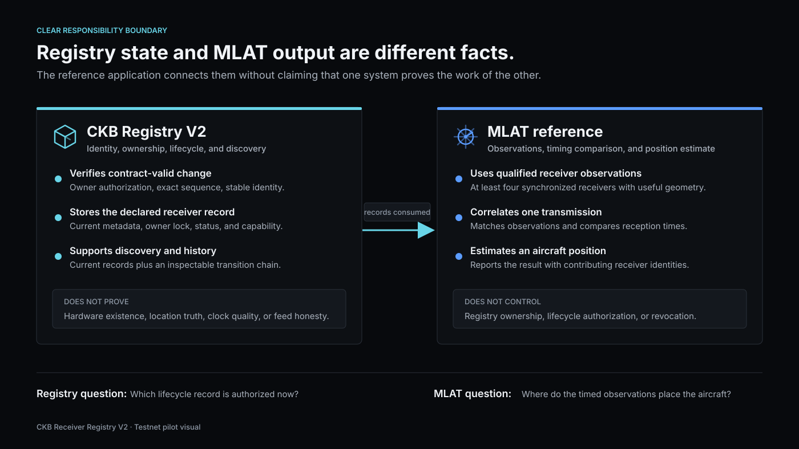

# Help Test A Shared Identity System For ADS-B Receivers

CKB Receiver Registry is an experimental browser-based tool for small ADS-B and
Mode S receiver networks. It gives a receiver one permanent identity while its
details, owner, or operating status change. Receiver owners control their own
records, while network coordinators can discover current records and inspect who
approved each change.

We are preparing a small remote pilot to learn whether this solves a real
coordination problem. We want criticism as much as positive feedback. The result
may be to continue, change the product, or stop this product direction.

## Who We Need

We are looking for:

- **four receiver owners or operators** who operate an ADS-B or Mode S receiver
  now, or operated one within the last 12 months; and
- **two network coordinators or developers** who manage, monitor, or integrate
  data from multiple receivers.

No blockchain experience is required. Applicants should have practical receiver
or network experience that can be verified through a public project/profile or
private redacted evidence.

## What You Will Do

Receiver operators will create and update a non-sensitive test receiver record,
find it in a directory, inspect its history, and return within seven days to find
it again. These actions use CKB Pudge testnet, a testing network whose tokens have
no real monetary value.

Coordinators will find assigned receiver records, check owner and lifecycle
information, export the records as JSON, and assess what an integration with
their current process would require. A wallet is not required for these tasks.

The pilot does not connect to your receiver, collect a private feed, or test live
aircraft-location accuracy. It must not be used for aviation safety decisions.

## Commitment And Equipment

- One remote product test of up to 45 minutes.
- One interview of up to 20 minutes.
- One short follow-up within seven days.
- About 85-95 minutes total for receiver operators.
- About 90-120 minutes total for coordinators, including their integration
  follow-up.
- A laptop or desktop, current Chromium-based browser, microphone, and stable
  internet suitable for screen sharing.
- Receiver operators also need a supported CKB testnet wallet. Testnet funds are
  provided through the normal faucet process. Physical receiver hardware is not
  needed during the session.

Remote participants may be located anywhere they can lawfully use the test
software and attend a scheduled call in `[SESSION TIME ZONE / AVAILABLE HOURS]`.

## Privacy And Safety

We will never ask for your private key, seed phrase, password, exchange login,
feed key, private feed URL, IP address, exact receiver location, or access to your
receiver. Use fictional or deliberately coarse coordinates in test records.
Names and contact details are kept outside the public project evidence. Nothing
identifying is published without separate permission.

The software is experimental, testnet-only, and not independently audited. The
pilot will begin only after its contract review, wallet rehearsal, and hosted
test environment are complete.

## Incentive And Application

A proposed **$30 USD-equivalent completion incentive** depends on grant approval
and is not yet guaranteed. It would be paid after the test, interview, and
follow-up are complete.

To express interest, complete `[APPLICATION FORM LINK]` by `[APPLICATION
DEADLINE]` or contact `[PROJECT EMAIL]`. Applying does not commit you to take part
and does not guarantee selection. Participation is voluntary, and selected
participants may stop at any time.

Project source: <https://github.com/Jeremicarose/AIRCRAFT-MALT>
