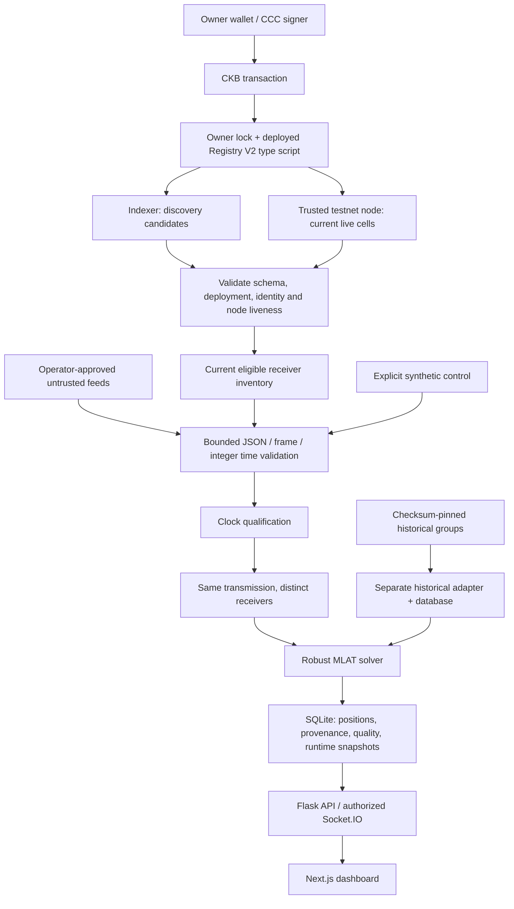

# Architecture and data flow

Reviewed 19 October 2026. See [audit](audit.md) for scope and starting state.
The Registry V2 contract is the identity/lifecycle product. The MLAT application
is its reference consumer. Neither is an aviation safety service.

The diagram shows shared numerical code. Historical and synthetic runs use
separate databases; historical data never enters the live correlator with invented
frames or fabricated timing qualification.

## Entry points and services

| Component | Entry / implementation | Responsibility |
| --- | --- | --- |
| Contract | `contracts/registry-v2/src/entry.rs`; `make test`, `make check` | Type-ID creation, one-input/one-output lifecycle, record validation, sequence continuity, permanent revocation |
| Python discovery | `src/ckb_registry/discovery.py` | Paginated indexer candidates, immutable deployment binding, fresh node verification, duplicate quarantine |
| TypeScript SDK | `sdk/typescript/src/{discovery,lifecycle,history}.ts` | Browser discovery, signer-owned transaction preparation, public lifecycle history |
| Processor | `mlat-processor` / `python -m mlat_reference.runtime` | Discovery refresh, feed supervision, validation, correlation, solve, write, telemetry |
| API | `mlat-api`; `mlat_reference.api.rest_api:app` under Gunicorn | REST reads, optional authenticated streaming, disabled-by-default administrative cleanup |
| Frontend | `reference/mlat/frontend`; `npm run build`, `npm start` | Registry directory/owner actions and MLAT operational console |
| Synthetic launcher | `run-demo.sh` → `render-entrypoint.sh` | Explicit synthetic processor and API, same SQLite database |
| Historical launcher | `run-replay.sh` | Checksum-verified offline dataset replay, isolated database, read-only API |
| Live launcher | `run-live.sh` | Strict preflight then processor/API; requires authorized feeds and clock configuration |

Docker Compose defines separate processor, API and frontend services. SQLite
must be on the same local host/volume. Multiple processor writers or horizontal
API scaling are not validated. The Render blueprint is a synthetic walkthrough.

## Identity, authorization and state

A receiver identity is the 32-byte Type-ID argument. Its human-readable label is
immutable but not globally unique. Different identities may share a label.
Ownership comes from the current cell's lock script, whose spending conditions
CKB verifies; an owner string in a feed or HTTP body grants nothing.

The contract accepts `online`, `offline`, `degraded`, and `revoked` record values.
For lifecycle presentation, the first three are **ACTIVE**; `revoked` is terminal
**REVOKED**. On-chain `online` is an owner's declaration, not a heartbeat.

| State dimension | Authority | Meaning |
| --- | --- | --- |
| Registry ACTIVE / REVOKED | Valid current cell under configured deployment | Lifecycle authorization only |
| Operational ONLINE / OFFLINE / STALE / DEGRADED | Observed feed arrivals, freshness and failures | Runtime availability; independent of registry declarations |
| MLAT qualification / eligibility | Current identity + permitted capability + valid observation/clock/geometry | Eligibility for a particular solve, not physical truth |

The runtime currently selects records declaring `online` with `mlat` capability.
Unknown, conflicted, revoked, or unverifiable identities are excluded. A successful
refresh removes pending observations for removed receivers; owner, sequence or
geometry changes reset clock qualification. Restart reconstructs the inventory
and removes obsolete persisted registry receivers.

Discovery verifies candidate bytes, output lock/type and liveness with the node.
A node error invalidates the snapshot; cached records are not an authority fallback.
The Python scan has a 30-second total deadline; SDK scans default to 30 seconds
and accept a bounded `timeoutMs`. Runtime refresh defaults to 30 seconds. Thus
revocation is observed on polling, not instantaneously: approximately one refresh
interval plus up to one scan deadline, with event-loop/host scheduling overhead.
This is not a hard real-time guarantee or a blockchain-finality policy.

## Observation and storage contracts

Each live observation needs a bound identity, original 56/112-bit Mode-S frame,
positive integer nanoseconds, source time, synchronization boolean, clock source,
and finite non-negative uncertainty. Registry coordinates supply geometry; feed
coordinates cannot replace them. JSON decimal strings preserve nanoseconds across
JavaScript's number precision limit. Epoch floats are only used for freshness and
compatible API fields; time differences use integer nanoseconds where available.

Default clock uncertainty is at most 100 ns, already part of the design. Light
travels about 30 m in 100 ns; two receiver errors and weak geometry can amplify
position error. A reported 100 ns bound does not certify a receiver's hardware.
The correlator uses the complete matching frame and a 5 ms runtime window, with
distinct identities, bounded buffering and duplicate/conflicting-claim rejection.
Clock-unqualified observations never enter a solve. Geometry and physical output
checks supplement the unchanged numerical solver.

SQLite schema version 2 stores source mode, source ID, nanoseconds as decimal
strings, event identity, receiver geometry, raw-frame availability, residual and
iteration diagnostics. Legacy rows remain UNKNOWN. A database is bound to one
source mode, preventing replay or synthetic rows being relabelled as LIVE.
WAL enables concurrent readers; a 30-second busy timeout can still stall the
single-node processor under contention. Backup uses SQLite's online backup API.

## External integrations and boundaries

- CKB node/indexer: configured HTTPS services, trusted for chain information.
  Node cross-checking does not make an untrusted or lagging node trustworthy.
- Feed WebSockets: exact operator-approved destinations; credentials/subscriptions
  go only to the configured primary endpoint; redirects are refused.
- Command JSONL/Beast bridges: operator-configured executables without a shell;
  still privileged code, with independently documented receiver clock mappings.
- Browser wallets: owner approves transactions in a CCC signer. Application
  code does not require raw private keys. Transactions consume capacity/fees.
- Map tiles: external cartography may be unavailable; tables and inspectors remain
  usable. Public map services may receive browser IP/referrer information.
- Optional reference acquisition: separate tools and credentials, not proof of
  accuracy merely because an external API is reachable.

The frontend proxy permits selected reads to the configured backend and applies
a request timeout. Registry writes are wallet transactions, not API owner-string
updates. The public read API exposes receiver coordinates and aircraft positions;
an external deployment must explicitly approve that disclosure or add access control.
